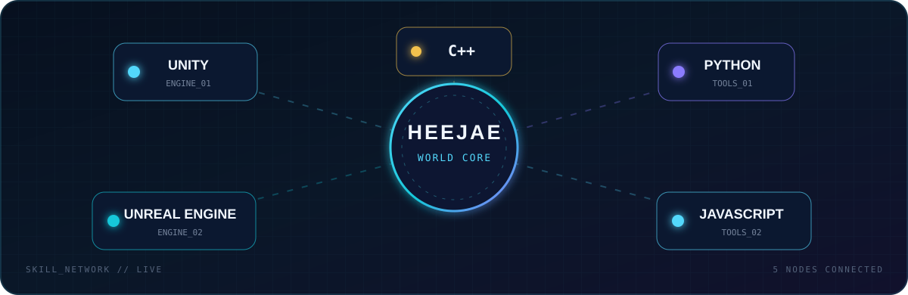

 

> **코드로 또 하나의 세계를 만드려는 창작자**

상상을 시스템으로, 시스템을 경험으로 바꾸는 과정을 좋아합니다. 
게임과 인터랙티브 콘텐츠를 통해 오래 기억되는 세계를 만들고 싶습니다.

---

| STATUS | FOCUS | CREATOR MODE |
|:--:|:--:|:--:|
| `ONLINE` | Game & Interactive Worlds | `IMAGINE → BUILD → EXPLORE` |

## `01 // CREATOR`

<table>
  <tr>
    <td width="33%" align="center">
      <b>IMAGINE</b> 
      장면과 이야기를 상상합니다.
    </td>
    <td width="33%" align="center">
      <b>BUILD</b> 
      아이디어를 코드로 구현합니다.
    </td>
    <td width="33%" align="center">
      <b>EXPLORE</b> 
      새로운 경험과 가능성을 탐험합니다.
    </td>
  </tr>
</table>

## `02 // CURRENT QUESTS`

<table>
  <tr>
    <td width="33%" valign="top">
      <h3>🎮 World Systems</h3>
      
규칙과 상호작용이 맞물려 살아 움직이는 게임 세계를 설계합니다.

      <code>C++ · Game Logic</code>
    </td>
    <td width="33%" valign="top">
      <h3>🪐 Interactive Worlds</h3>
      
플레이어가 직접 탐험하고 기억할 수 있는 공간과 경험을 만듭니다.

      <code>Unity · Unreal Engine</code>
    </td>
    <td width="33%" valign="top">
      <h3>🧪 Creative Prototypes</h3>
      
떠오른 아이디어를 빠르게 실험하며 새로운 가능성을 발견합니다.

      <code>Python · JavaScript</code>
    </td>
  </tr>
</table>

## `03 // SKILL MAP`

### Toolkit

**WORLD ENGINES**

**LANGUAGES**

## `04 // JOURNEY`

<!-- 경력을 추가할 때 이 주석 아래에 내용을 작성하세요. -->

> `NEW CHAPTER // READY FOR THE NEXT QUEST`

 

## `05 // ACHIEVEMENTS`

<!-- 자격증이나 수상 경력을 추가할 때 이 주석 아래에 내용을 작성하세요. -->

> `EMPTY SLOT // FUTURE ACHIEVEMENT WILL BE UNLOCKED HERE`

 

## `06 // SIGNAL`

 
 

---

`IMAGINE → BUILD → EXPLORE`

